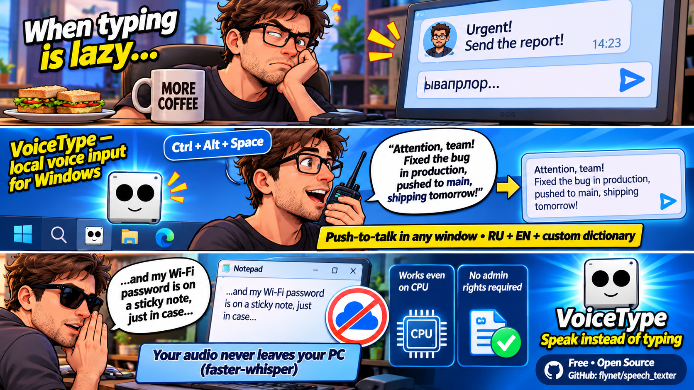
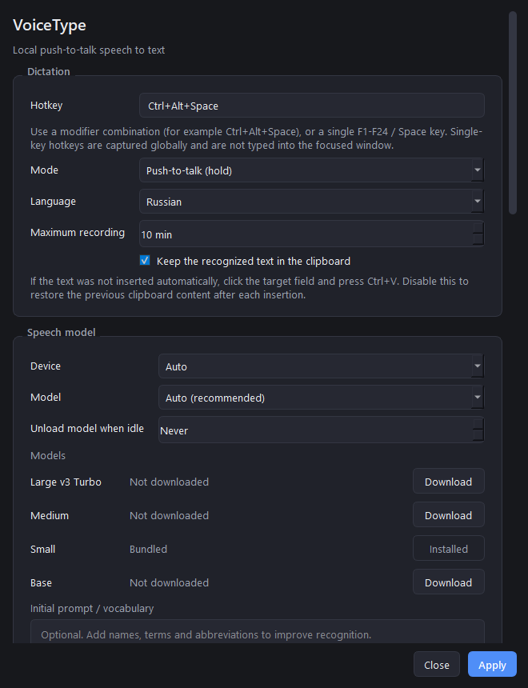
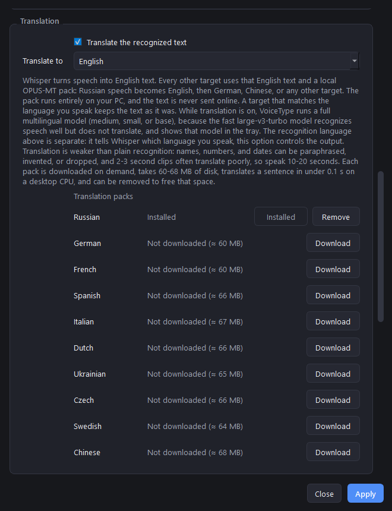
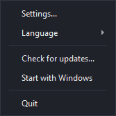

# VoiceType

VoiceType is a local push-to-talk speech-to-text app for Windows. Press a global
hotkey, speak, release, and the recognized text is inserted into the input field
that currently has focus. Audio never leaves the machine: recognition runs
locally with [faster-whisper](https://github.com/SYSTRAN/faster-whisper) and
CTranslate2.



## Features

- Global hotkey (push-to-talk by default, toggle mode available)
- Local Russian, English, or automatic language recognition
- Optional offline translation: any language to English with Whisper, and to
  Russian, German, French, Spanish, Italian, Dutch, Ukrainian, Czech, Swedish,
  or Chinese with a downloadable local OPUS-MT pack
- Automatic GPU detection with a safe CPU fallback
- Tray icon, no main window, and a small always-on-top recording overlay
- Model manager: `base`, `small`, `medium`, and `large-v3-turbo`
- Built-in test bench in Settings: record a short sample with the currently
  selected model, device, and microphone without saving them, so models and
  microphones can be compared before applying
- Optional CUDA acceleration pack downloaded separately from GitHub Releases
- Optional autostart, notification sounds, initial prompt, idle model unload
- Built-in updater verified with SHA-256
- Help button in Settings opens the GitHub issues page for reports and questions
- Single-instance application, per-user installer

## Screenshots

The main settings window. The first screen covers the hotkey and the speech
model; the second shows translation, audio, and the test bench.





The tray menu and the recording overlay that appears while the hotkey is held:

<p>
  
  
</p>

Screenshots use demo values for the microphone and model list; on your system
they reflect the devices and models that are actually available.

## Requirements

- Windows 10 21H1 or newer, Windows 11 recommended (64-bit)
- 4 GB RAM minimum, 8 GB recommended
- Any x64 CPU; an NVIDIA GPU is optional
- Microphone

GPU mode uses NVIDIA CUDA through CTranslate2. An NVIDIA GPU is optional: on
any other hardware VoiceType runs on the CPU automatically. See
[Hardware and CPU fallback](#hardware-and-cpu-fallback) for details.

## Install

1. Download `VoiceType-Setup-<version>.exe` from
   [Releases](https://github.com/flynet/speech_texter/releases/latest).
2. Verify the download with `SHA256SUMS.txt` if desired.
3. Run the installer. The default installation is per-user and does not require
   administrator rights.
4. VoiceType starts in the system tray. The bundled `small` model is ready
   immediately.

The installer is not code-signed, so Windows SmartScreen may show a warning.
Choose **More info → Run anyway** after verifying the checksum.

## Getting started

1. Open **Settings** from the tray icon.
2. Click the hotkey field and press the desired combination (default:
   `Ctrl+Alt+Space`). A single `F1`–`F24` key or `Space` can also be used.
3. Choose the language and, optionally, a microphone. To translate the recognized
   text, enable **Translate the recognized text** and pick **Translate to**; the
   target selector is a separate setting from the language you speak. English is
   produced by Whisper itself, with no extra download. Every other target runs on
   a local OPUS-MT pack, so download its **Translation packs** row in Settings
   first: speech is turned into English by Whisper, then into the target by the
   pack, so Russian speech becomes German, Chinese, or any other target through
   English. While translation is on, VoiceType runs a full multilingual model
   (`medium`, `small`, or `base`), because the fast `large-v3-turbo` model
   recognizes speech well but does not translate it.
4. Click **Apply**.
5. Focus any text field (Notepad, a browser, a chat app) and hold the hotkey.
   Speak while holding it, then release. The recognized text is pasted into the
   focused input.

The first GPU transcription may take a few seconds while the model is loaded.
The overlay shows `Processing` while VoiceType is busy; new recordings are
ignored until the current one is inserted.

If no text field had focus when recognition finished, nothing is inserted and
the recognized text stays on the clipboard. Click the intended input and press
`Ctrl+V` to paste it. This fallback is enabled by **Keep the recognized text in
the clipboard** in Settings; disable it if you prefer VoiceType to restore the
previous clipboard content after every insertion.

### Modes

- **Push-to-talk (hold)** — recording runs while the hotkey is held. Releasing
  the hotkey stops recording and starts recognition.
- **Toggle** — press once to start, press again to stop.

Recordings shorter than 0.3 seconds are ignored. The maximum recording length is
configurable (10 minutes by default).

A single-key hotkey (for example `F5` or `Space`) is captured by VoiceType and
does not reach the focused application. This also means that while `Space` is
configured as the hotkey, VoiceType consumes Space presses system-wide — choose
`Space` only if you do not need to type spaces elsewhere.

## Settings

| Setting | What it does |
| --- | --- |
| **Hotkey** | Global combination that starts recording. Press a modifier combination (for example `Ctrl+Alt+Space`) or a single `F1`–`F24` / `Space` key. The hotkey works in every application and does not take focus away from the window you are typing in. |
| **Mode** | `Push-to-talk (hold)` records while the key is held and stops on release. `Toggle` starts recording on the first press and stops it on the second. |
| **Language** | Recognition language: Russian, English, or `Auto`. Auto detects the language for every recording and can handle mixed speech, but it is slightly less predictable for short phrases. This setting tells Whisper **which language you speak**; it is separate from translation. |
| **Translate the recognized text** | Off by default. When enabled, VoiceType converts the recognized text into the target language. English comes from the built-in Whisper `translate` task, running fully offline with no extra download. Every other target runs on a local OPUS-MT pack through English. Translation needs a full multilingual model, so while this option is on VoiceType uses `medium`, `small`, or `base` and shows that model in the tray, even if `large-v3-turbo` was selected for plain recognition. If the target matches the language you speak, the text is kept as it was recognized. |
| **Translate to** | Target language: English, Russian, German, French, Spanish, Italian, Dutch, Ukrainian, Czech, Swedish, Chinese. English needs no download; the other languages use a pack from the list below. The selector is enabled only while translation is on, and is separate from the **Language** you speak. |
| **Translation packs** | Pack manager: one row per target language with its size (60-68 MB), a **Download** button with progress and cancel, and **Remove** for an installed pack. Packs are converted OPUS-MT models in the CTranslate2 format, verified against `SHA256SUMS.txt`, stored in `%LOCALAPPDATA%\VoiceType\translation`, and used only on your PC. |
| **Maximum recording** | Hard limit from 1 to 60 minutes (10 by default). Recording also stops when the hotkey is released in push-to-talk mode. Recordings shorter than 0.3 seconds are ignored. |
| **Keep the recognized text in the clipboard** | When enabled (default), the last transcription stays on the clipboard, so if the paste target had no focus you can click the field and press `Ctrl+V`. Disable it to restore the previous clipboard content after each automatic insertion. |
| **Device** | `Auto` uses CUDA when a usable NVIDIA GPU and the CUDA pack are available, otherwise the CPU. `CUDA (NVIDIA)` forces the GPU when possible and falls back to the CPU if CUDA cannot be initialized. `CPU` always uses the processor. |
| **Model** | `Auto (recommended)` picks the best downloaded model for the current device. You can also pin `Base`, `Small`, `Medium`, or `Large v3 Turbo`. If the selected model has not been downloaded, VoiceType uses the best model that is available. |
| **Unload model when idle** | Frees RAM and VRAM after the selected number of idle minutes (0–120, `Never` by default). The next recording reloads the model, which adds a short delay. |
| **Models** | Model manager. `Small` is bundled with the installer and marked `Bundled`/`Installed`. Other models show `Not downloaded` with a **Download** button; an active download can be cancelled. |
| **Initial prompt / vocabulary** | Optional text passed to Whisper before recognition. Add names, product terms, abbreviations, or unusual spellings to make them more likely to be recognized correctly. Keep it short; a long prompt may bias the output. |
| **Microphone** | Input device. `System default` follows the Windows default device; choosing a specific microphone overrides it. **Refresh** re-scans the device list after connecting or disconnecting a microphone. |
| **Test model and microphone** | A demo bench next to the microphone selector. Press **Start test**, speak for up to 30 seconds, press **Stop and recognize**: the recognized text appears with the model, device, microphone, duration and RTF of that run, plus `translated to German` when translation is on. It uses the values selected above **without saving them**, so you can compare models, microphones, and translation modes freely, then press **Apply** once at the end. Global hotkeys are paused while testing, and the main dictation pipeline is left untouched. |
| **Sounds** | Plays a short tone when recording starts and a different one when it stops. |
| **Overlay position** | Where the recording overlay appears: bottom center (default), bottom left, bottom right, or top center. The overlay ignores mouse input and never takes focus. |
| **Start with Windows** | Adds or removes a per-user `HKCU\Software\Microsoft\Windows\CurrentVersion\Run` entry. No administrator rights are required. |
| **CUDA pack** | Available only when an NVIDIA GPU is detected; on other hardware Settings shows `No NVIDIA GPU detected. CPU mode will be used.` Downloads and verifies the optional cuBLAS/cuDNN libraries used for GPU acceleration; without it VoiceType stays on the CPU. |
| **Check for updates** | Checks GitHub Releases, compares versions, downloads the installer, verifies its SHA-256 checksum, and runs the silent installer. Automatic checks are throttled to once per day. |
| **Help** | Opens `https://github.com/flynet/speech_texter/issues` in the default browser, so a problem, question, or feature request can be reported from Settings. If the browser cannot be opened, the link is shown in a dialog. |

Most changes take effect after pressing **Apply**. The hotkey can be changed
while VoiceType is running; other settings may reload the model or restart audio
capture.

### How Auto chooses a device and model

`Device = Auto` checks for an NVIDIA GPU, loadable CUDA libraries, and at least
800 MB of free VRAM. If all three are present, CUDA is used; otherwise VoiceType
uses the CPU and logs the reason (for example `No NVIDIA GPU detected`). The
reason is also visible in the tray tooltip and the log file.

`Model = Auto` then picks:

- On CUDA with at least 1400 MB of free VRAM and a downloaded
  `large-v3-turbo` — `large-v3-turbo`;
- on CUDA otherwise — `small` if installed;
- on CPU with 6 or more physical cores — `small`;
- on slower CPUs — `base` if installed, otherwise `small`.

The bundled `small` model makes CPU mode usable immediately after installation,
without any download.

### Models

| Model | Approximate size | Notes |
| --- | --- | --- |
| `base` | 141 MB | Fastest, lowest accuracy |
| `small` | 464 MB | Bundled default, good CPU/GPU balance |
| `medium` | 1.46 GB | Better accuracy, slower |
| `large-v3-turbo` | 1.55 GB | Best quality, needs a capable GPU |

Model files are downloaded directly from Hugging Face with pinned revisions.
Downloads can be cancelled and are resumed at file granularity.

## Hardware and CPU fallback

VoiceType works on any 64-bit Windows machine with a modern x64 CPU. An NVIDIA
GPU is an optional accelerator, not a requirement. Every faster-whisper model
runs on the CPU through CTranslate2 with `int8` quantization; CUDA mode uses
`int8_float16`.

| Your hardware | What happens |
| --- | --- |
| **No discrete GPU** (Intel HD/UHD, AMD integrated graphics, or a headless VM) | CPU mode. No driver, CUDA, or extra setup is needed. |
| **AMD Radeon** (any model) | CPU mode. CUDA is NVIDIA-only, so Radeon GPUs are not used for recognition, even with the CUDA pack installed. |
| **Intel Arc** | CPU mode. Arc GPUs are not used by CTranslate2's CUDA backend and are treated like any other non-NVIDIA GPU. |
| **NVIDIA GPU without the CUDA pack** | CPU mode until the **CUDA pack** is downloaded from Settings (or CUDA libraries are already installed system-wide). |
| **NVIDIA GPU + CUDA pack, less than 800 MB free VRAM** | CPU mode to avoid out-of-memory errors. Close GPU-heavy applications and restart VoiceType to retry. |
| **NVIDIA GPU + CUDA pack, enough free VRAM** | CUDA mode, which is significantly faster than the CPU. |
| **CUDA initialization or transcription fails** | Automatic fallback to the CPU; the reason is shown in a tray notification and written to the log. |

CPU speed depends on the processor, but it is fully functional for all four
models. As a reference, `small` on an Intel Core i5-12500H runs at about
0.077 RTF on the CPU — roughly 13 times faster than real time for this sample.
Very old or low-power CPUs may run slower than real time with `medium` or
`large-v3-turbo`; in that case use `base` or `small`.

To force CPU mode at any time, set **Device** to **CPU**. This is also the
quickest way to rule out a GPU problem when troubleshooting.

## GPU acceleration

VoiceType detects NVIDIA GPUs automatically. The installer does **not** include
CUDA libraries; instead, the app can download an optional CUDA pack
(`cuda-pack-v1`) from GitHub Releases on first run or from Settings. AMD and
Intel Arc GPUs are not used by this CUDA path; those systems always run on the
CPU.

- Default path: `%LOCALAPPDATA%\VoiceType\cuda`
- The archive is verified against `SHA256SUMS.txt` before extraction
- Only the required cuBLAS and cuDNN DLLs are installed
- If CUDA initialization or transcription fails, VoiceType falls back to the
  CPU and reports the reason in a tray notification

The development machine (RTX 4060 Laptop, 8 GB) is used for real measurements.
Use the benchmark script below to measure your own hardware.

## Data locations

| Path | Contents |
| --- | --- |
| `%APPDATA%\VoiceType\config.json` | Settings |
| `%LOCALAPPDATA%\VoiceType\models` | Downloaded models |
| `%LOCALAPPDATA%\VoiceType\cuda` | Optional CUDA DLLs |
| `%LOCALAPPDATA%\VoiceType\logs\app.log` | Rotating log file |

Uninstalling keeps settings and downloaded models. Remove the two directories
above manually for a full cleanup.

## Building from source

### Prerequisites

- Python 3.12 (64-bit)
- [Inno Setup 6](https://jrsoftware.org/isinfo.php) for the installer
- Git

### Setup

```powershell
git clone https://github.com/flynet/speech_texter.git
cd speech_texter
python -m venv .venv
.\.venv\Scripts\python.exe -m pip install --upgrade pip
.\.venv\Scripts\python.exe -m pip install -r requirements.txt -r requirements-build.txt
```

Run from source:

```powershell
$env:PYTHONPATH = "src"
.\.venv\Scripts\python.exe -m voicetype
```

On Windows you can also double-click `run-test.cmd`, which starts the same
source build and keeps the log visible in the console window.

### Build the application

```powershell
.\.venv\Scripts\python.exe scripts\generate_assets.py
.\.venv\Scripts\python.exe scripts\fetch_models.py --models small
.\.venv\Scripts\pyinstaller.exe --noconfirm --clean voicetype.spec
New-Item -ItemType Directory -Force dist\VoiceType\models | Out-Null
Copy-Item -Recurse -Force models\small dist\VoiceType\models\small
```

`models` must be copied next to `dist\VoiceType\VoiceType.exe`, not into
`dist\VoiceType\_internal`.

### Build the installer

```powershell
iscc /DMyAppVersion=0.3.0 installer\voicetype.iss
```

The result is written to `dist-installer\VoiceType-Setup-0.3.0.exe`.

### Build the CUDA pack

```powershell
.\.venv\Scripts\python.exe scripts\build_cuda_pack.py --output dist-cuda
```

This downloads the pinned `nvidia-cublas-cu12` and `nvidia-cudnn-cu12` wheels,
extracts the Windows DLLs, creates `voicetype-cuda-pack.zip`, and writes
`SHA256SUMS.txt`. The **CUDA pack** GitHub Actions workflow (tag
`cuda-pack-v*` or manual dispatch) publishes the result as release
`cuda-pack-v1`.

### Build the translation packs

Building packs needs the Hugging Face converter, so install the build-time tools
and a CPU torch build first. The app itself never uses torch, and
`requirements-build.txt` (PyInstaller only) does not pull it, so the installer
build stays small:

```powershell
.\.venv\Scripts\python.exe -m pip install -r requirements-packs.txt
.\.venv\Scripts\python.exe -m pip install torch --index-url https://download.pytorch.org/whl/cpu
.\.venv\Scripts\python.exe scripts\build_mt_packs.py --dist dist-mt-packs
```

This converts every pinned Helsinki OPUS-MT model to CTranslate2 `int8`, adds
the two Marian options the HF converter leaves out (`model_type`,
`add_source_eos`), writes `NOTICE.txt` and `SOURCE.json` into each archive, and
creates `SHA256SUMS.txt`. Each pack is 60–68 MB. The **Translation packs**
workflow (tag `mt-packs-v*` or manual dispatch) publishes the archives as
release `mt-packs-v1`. VoiceType downloads a pack on demand from Settings,
verifies its SHA-256 against `SHA256SUMS.txt`, and installs it in
`%LOCALAPPDATA%\VoiceType\translation`; packs never enter the installer.

## Benchmarks

`scripts/bench.py` measures wall time, real-time factor (RTF), and peak VRAM for
any audio file supported by PyAV.

```powershell
.\.venv\Scripts\python.exe scripts\bench.py --audio tests\audio\ru_60s.wav
.\.venv\Scripts\python.exe scripts\bench.py --audio tests\audio\ru_60s.wav `
    --model small --device cpu --repeat 3 --output bench-results.json
```

Recommended test audio: 16 kHz, mono, PCM WAV, 60 seconds and 3 minutes of
Russian speech. See `tests/audio/README.md`.

RTF below 1.0 means transcription is faster than real time. Results depend on the
model, device, CPU, and GPU.

Measured on the development machine (Intel Core i5-12500H, NVIDIA GeForce RTX
4060 Laptop 8 GB, Windows 11) with 60 seconds of spontaneous Russian speech,
warmup 1, repeat 2, VAD enabled:

| Model | Device | RTF | Model load | Peak used VRAM |
| --- | --- | --- | --- | --- |
| `small` | CPU (`int8`) | 0.077 | 0.87 s | n/a |
| `small` | CUDA (`int8_float16`) | 0.038 | 1.07 s | ~2.0 GB total |
| `medium` | CUDA (`int8_float16`) | 0.072 | 2.70 s | ~2.6 GB total |
| `large-v3-turbo` | CUDA (`int8_float16`) | 0.027 | 2.79 s | ~2.6 GB total |

For a 3-minute recording (the 61 s sample repeated to 180 s):

| Model | Device | Time | RTF |
| --- | --- | --- | --- |
| `small` | CPU (`int8`) | 14.03 s | 0.078 |
| `small` | CUDA (`int8_float16`) | 6.97 s | 0.039 |
| `large-v3-turbo` | CUDA (`int8_float16`) | 4.16 s | 0.023 |

The curated CUDA pack is 642.6 MB compressed (919.2 MB uncompressed) and was
verified with `small`, `medium`, and `large-v3-turbo`. The PyInstaller application
directory is 336.4 MB without models.

### Translation packs

`scripts/bench_translation.py` measures cold pack load, CPU latency, memory, and
reference coverage on 20 fixed dictation phrases (175 words), with human
translations as references, on the same machine, CPU only, 4 threads, `int8`,
3 passes:

| Pack | Load | Latency | Per word | Memory | Coverage |
| --- | --- | --- | --- | --- | --- |
| `en-ru` | 0.28 s | 0.06 s / phrase | 6.5 ms | 100 MB | 0.63 |
| `en-de` | 0.31 s | 0.06 s / phrase | 6.7 ms | 91 MB | 0.85 |
| `en-fr` | 0.31 s | 0.06 s / phrase | 7.2 ms | 93 MB | 0.88 |
| `en-es` | 0.30 s | 0.06 s / phrase | 7.3 ms | 96 MB | 0.82 |
| `en-it` | 0.35 s | 0.07 s / phrase | 8.4 ms | 105 MB | 0.76 |
| `en-nl` | 0.33 s | 0.06 s / phrase | 7.3 ms | 98 MB | 0.83 |
| `en-uk` | 0.34 s | 0.06 s / phrase | 6.6 ms | 94 MB | 0.62 |
| `en-cs` | 0.32 s | 0.06 s / phrase | 7.3 ms | 94 MB | 0.66 |
| `en-sv` | 0.31 s | 0.05 s / phrase | 5.9 ms | 91 MB | 0.83 |
| `en-zh` | 0.32 s | 0.05 s / phrase | 6.0 ms | 100 MB | 0.72 |

Coverage counts the reference words, digits, and Chinese characters the
translation kept, so it underestimates Russian, Ukrainian, and Czech, where the
pack picks different word forms than the reference. Every number in the
references was preserved, no output was empty, and one loaded pack uses about
100 MB of RAM.

The A/B check on 60 s of real Russian speech (`small` on CPU, `language=ru`)
measures the three stages against each other:

| Stage | Time | What it did |
| --- | --- | --- |
| `task="transcribe"` | 6.46 s | Russian text, faithful to the recording |
| `task="translate"` | 9.45 s | English text, 46% slower, invented and dropped numbers: spoken "60 секунд" became `10 seconds`, spoken `Разве 3-4-5 вышел` became `1,2,3,4,5`, "рейтинг 4,2 из 5 946 голосов" became `the ZGB is a 4.2-inch instrument from 5,946` |
| OPUS-MT `en-de` pack | 0.68 s | German text from the English stage, numbers carried through, one token (`4`) dropped from `1,2,3,4,5` |

The pack stage is fast and faithful to the text it is given. The quality risk
sits in the Whisper stage: a pivoted target inherits every number Whisper
paraphrased. Translation for meaning, not for verbatim notes.

## Manual acceptance checklist

- [ ] First run with no internet shows a clear error and opens Settings
- [ ] Hotkey works in Notepad and in a browser text field
- [ ] Text is inserted into the focused field; focus is not stolen by VoiceType
- [ ] With no focused text field, the transcription remains on the clipboard and `Ctrl+V` pastes it
- [ ] Disabling the clipboard fallback restores the previous clipboard content
- [ ] A press shorter than 0.3 s is ignored
- [ ] A 3-minute recording transcribes correctly and does not block the UI
- [ ] New recordings are ignored while the overlay shows `Processing`
- [ ] CPU mode works on a machine without an NVIDIA GPU
- [ ] CUDA mode falls back to CPU if the CUDA pack is missing or broken
- [ ] With **Translate the recognized text** on, Russian speech becomes English text; with it off, the original language output is returned
- [ ] With translation on, the tray status shows a full multilingual model (`medium`, `small`, or `base`) and `translate → EN` for an English target, not `large-v3-turbo`
- [ ] The tray shows the selected target (`translate → DE` for German), and the test bench result names it
- [ ] The **Language** selector and the translation target selector act independently
- [ ] A target that needs a pack reports the missing pack before Whisper loads, and its row in Settings downloads it with progress and cancel
- [ ] Russian speech with target German gives German text through the English stage; English speech with target Russian gives Russian text
- [ ] A target that matches the spoken language keeps the recognized text as it was
- [ ] **Remove** deletes an installed pack, the row goes back to **Download**, and the disk space is freed
- [ ] Hovering a pack row shows its source model and license
- [ ] Autostart toggles survive a reboot / sign-out
- [ ] Single instance: launching a second copy shows a message
- [ ] Update check finds the latest release and verifies SHA-256
- [ ] Uninstall keeps `%APPDATA%\VoiceType` and `%LOCALAPPDATA%\VoiceType`

## Troubleshooting

- **No text is inserted.** Some elevated applications (for example Task Manager)
  reject synthetic input from a non-elevated app. Run VoiceType at the same
  privilege level as the target application. If no input had focus at all, the
  transcription is still on the clipboard: click the target field and press
  `Ctrl+V`.
- **The hotkey does nothing in a specific app.** Global hotkeys are captured at
  the system level; if another app registers the same combination, choose a
  different one.
- **Clipboard is not restored.** VoiceType saves and restores plain text only.
  Non-text clipboard formats (images, files, rich text) are not preserved.
- **Microphone not found.** Reconnect the device, open Settings, and press
  **Refresh**.
- **CUDA errors.** Check `%LOCALAPPDATA%\VoiceType\logs\app.log`. VoiceType
  should fall back to CPU automatically; you can also set **Device** to **CPU**.
- **Translation stops with "pack is not downloaded".** A target other than
  English needs its local pack. Open Settings, press **Download** on the row for
  that language, and dictate again. If the target matches the language you speak,
  the recognized text is kept as it was.
- **Antivirus warnings.** PyInstaller executables are sometimes flagged. Verify
  the SHA-256 checksum and add an exclusion only if you trust the release.

Logs are written to `%LOCALAPPDATA%\VoiceType\logs\app.log` (rotated, up to four
files of 1 MB).

## Privacy

VoiceType does not upload audio or recognized text. Network access is used only
for:

- downloading models from Hugging Face;
- downloading the optional CUDA pack from GitHub Releases;
- downloading translation packs from GitHub Releases;
- checking for updates on GitHub.

Translation into English uses the same local Whisper model, so no audio or text
is sent anywhere for it. Other target languages run a local OPUS-MT pack on your
own PC: the pack download is the only network call, and the text that is
translated never leaves the machine.

## Limitations

- Windows only (global hotkeys, clipboard integration, and installer are
  Windows-specific).
- Every target except English runs through English: Whisper turns speech into
  English text, a local OPUS-MT pack turns that text into the target language.
  Russian→German directly is not available, because OPUS-MT has no usable
  Russian–German pair. Two stages mean two chances to lose a detail, and the
  pack adds 0.05–0.07 s per phrase.
- A non-English target needs its pack downloaded once (60–68 MB per language).
  VoiceType stops with a clear message when the pack is missing, and **Remove**
  in Settings frees the space again.
- The ten packs in Settings cover the targets that OPUS-MT provides as a direct
  English pair. Polish, Turkish, Japanese, and Korean have no such pair with a
  usable language token, so they are not in the list.
- Translation quality is lower than plain recognition: names, numbers, and dates
  can be paraphrased, invented, or dropped. Enable it when meaning matters more
  than exact wording, and keep it off for verbatim notes.
- Translation needs full multilingual models: `large-v3-turbo` recognizes speech
  very well but keeps the source language, so VoiceType runs `medium`, `small`,
  or `base` while translation is on. If none of them is downloaded, VoiceType
  reports it and asks for a download in Settings.
- Whisper translation needs enough speech to work with: two- and three-second
  clips are often translated poorly, sometimes into a single word. Speak
  10–20 seconds for usable English output.
- Text insertion uses the clipboard and a synthetic `Ctrl+V`, so the target
  application must support pasting.
- With the clipboard fallback enabled (default), the transcription replaces the
  previous plain-text clipboard content. Disable the option to restore it after
  each insertion; non-text clipboard formats are not preserved.
- The application is not code-signed.

## License

The VoiceType source is MIT — see [LICENSE](LICENSE).

Third-party parts keep their own licenses, and nothing non-commercial is used:

| Component | License |
| --- | --- |
| faster-whisper, Whisper models | MIT |
| CTranslate2 | MIT |
| PySide6 / Qt | LGPL-3.0, dynamically linked |
| sounddevice | LGPL-2.1 |
| pynput, huggingface-hub, requests | MIT / Apache-2.0 |
| numpy, psutil | BSD |
| OPUS-MT / Tatoeba-Challenge source models (`Helsinki-NLP/opus-mt-en-*`), converted to CTranslate2 by `scripts/build_mt_packs.py` | Apache-2.0, `opus-mt-en-de` is CC-BY-4.0 |
| sentencepiece | Apache-2.0 |

Models under a non-commercial license (for example NLLB, CC-BY-NC-4.0) are not
compatible with this project, so they are not part of the plan.
